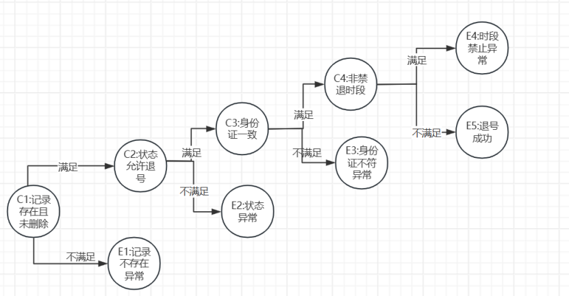
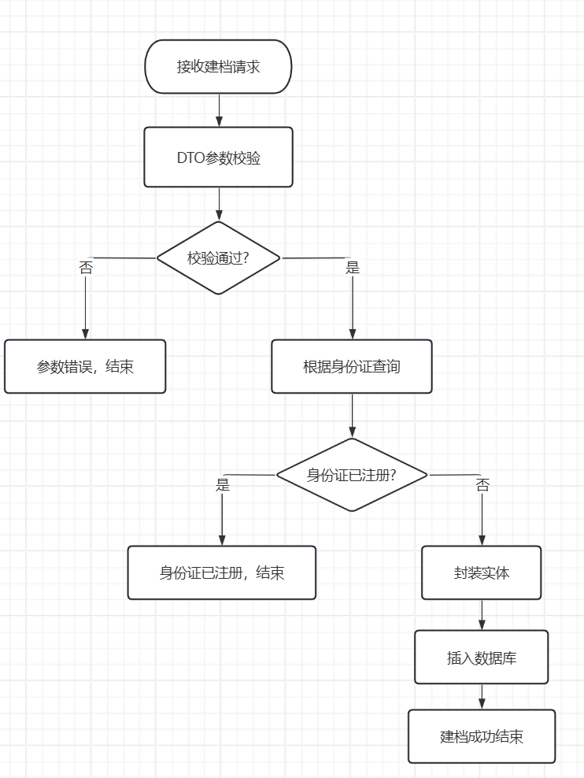
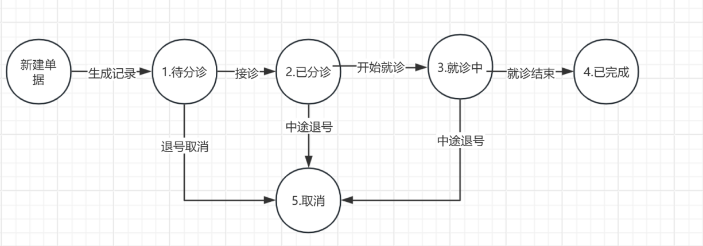
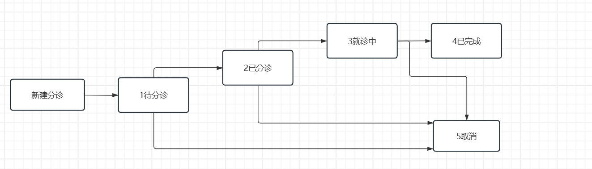
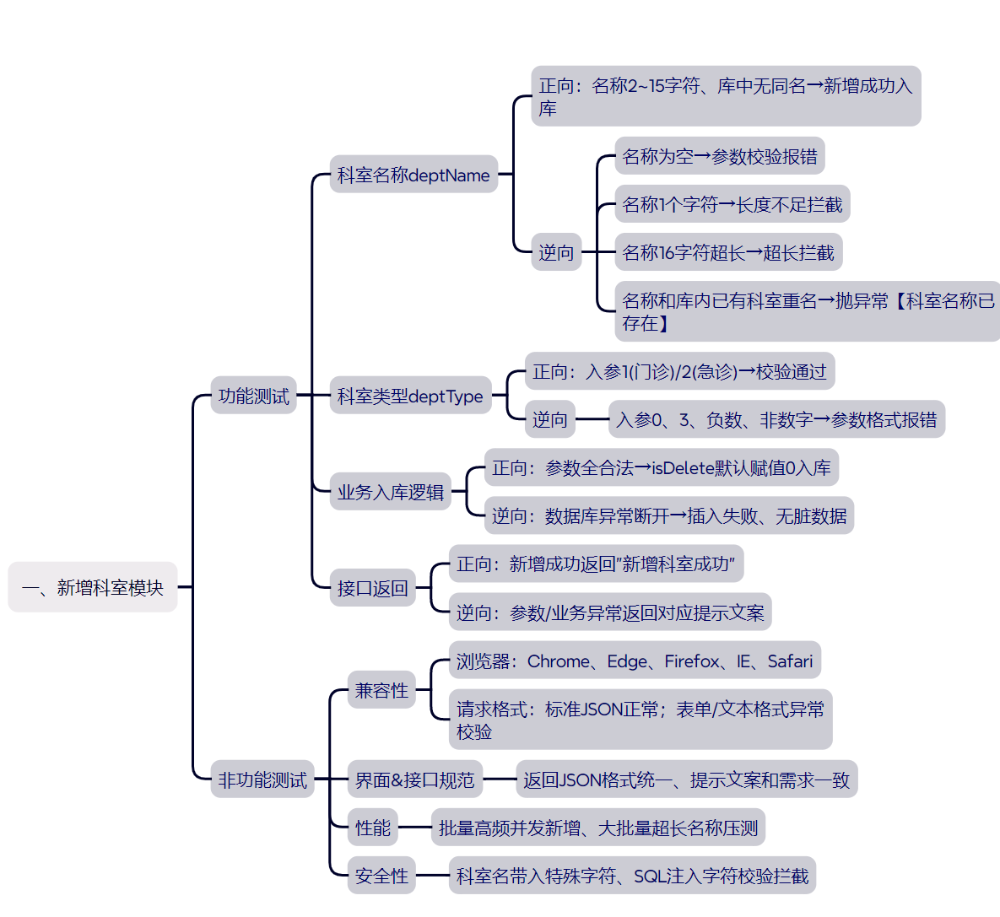

# 一、黑盒测试

> 项目：医院管理系统（后台接口）
> 测试方式：Postman / HTTP 接口手工测试
> 说明：黑盒测试不关心代码内部实现，只依据**需求与接口文档**设计输入，验证接口的输入校验、业务规则、状态流转是否符合预期。

## 1.0 测试范围概览

本项目针对 7 个后端接口，分别采用 7 种黑盒方法设计用例：

| 序号 | 测试方法 | 被测接口 | 测试重点 |
|---|---|---|---|
| 1 | 等价类划分法 | `POST /triage/add` | 分诊新增的 8 个入参字段校验 |
| 2 | 边界值分析法 | `GET /triage/page` | 分页参数与筛选参数的边界取值 |
| 3 | 因果图 + 决策表法 | `POST /triage/cancel` | 退号的多条件组合与业务规则判定 |
| 4 | 正交实验设计法 | `POST /doctor/add` | 4 因子 × 2 水平的参数组合覆盖 |
| 5 | 场景法 | `POST /patient/register` | 患者建档的基本流与备选流 |
| 6 | 状态迁移图法 | `POST /triage/update/status` | 分诊单据 5 种状态之间的合法迁移 |
| 7 | 思维导图法 | `POST /dept/add` | 科室新增的功能 + 非功能测试项发散 |

---

## 1.1 等价类划分法

**被测接口**：`http://localhost:8080/triage/add`（分诊新增）

**测试思路**：把每个入参的输入域划分为「有效等价类」和「无效等价类」，有效等价类用一个用例覆盖，每个无效等价类单独设计一个用例，保证既不冗余也不遗漏。

### 1.1.1 等价类划分表

| 字段（参数）         | 有效等价类                                       | 有效编号 | 无效等价类        | 无效编号 |
| -------------------- | ------------------------------------------------ | -------- | ----------------- | -------- |
| patientName 患者姓名 | 非空白，长度 2～20 字符                          | E1       | 空字符串 `""`     | N1       |
|                      |                                                  |          | 全空格            | N2       |
|                      |                                                  |          | 长度 = 1          | N3       |
|                      |                                                  |          | 长度 ≥ 21         | N4       |
| patientPhone 手机号  | 非空白，11 位、1 开头、第二位 3-9、剩余 9 位数字 | E2       | 空串 `""`         | N5       |
|                      |                                                  |          | 全空格            | N6       |
|                      |                                                  |          | 位数 < 11         | N7       |
|                      |                                                  |          | 位数 > 11         | N8       |
|                      |                                                  |          | 首位 ≠ 1          | N9       |
|                      |                                                  |          | 第二位为 0/1/2    | N10      |
|                      |                                                  |          | 含字母 / 特殊符号 | N11      |
| idCard 身份证        | 非空白，符合 18 位身份证正则规则                 | E3       | 空串 `""`         | N12      |
|                      |                                                  |          | 全空格            | N13      |
|                      |                                                  |          | 长度 ≠ 18         | N14      |
|                      |                                                  |          | 年月日非法        | N15      |
|                      |                                                  |          | 含非法特殊字符    | N16      |
| patientAge 年龄      | 非 null，0 ≤ 数值 ≤ 120                          | E4       | 传 null           | N17      |
|                      |                                                  |          | 数值 < 0          | N18      |
|                      |                                                  |          | 数值 > 120        | N19      |
| gender 性别          | 非 null，取值 1 或 2                             | E5       | 传 null           | N20      |
|                      |                                                  |          | 数值 < 1          | N21      |
|                      |                                                  |          | 数值 > 2          | N22      |
| departmentId 科室 ID | 非 null，1 ≤ 数值 ≤ 4                            | E6       | 传 null           | N23      |
|                      |                                                  |          | 数值 < 1          | N24      |
|                      |                                                  |          | 数值 > 4          | N25      |
| doctorId 医生 ID     | 非 null，1 ≤ 数值 ≤ 6                            | E7       | 传 null           | N26      |
|                      |                                                  |          | 数值 < 1          | N27      |
|                      | ``                                               |          | 数值 > 6          | N28      |
| symptom 病症描述     | 可为空 / 空格；非空时长度 ≤ 200                  | E8       | 字符长度 > 200    | N29      |

### 1.1.2 等价类测试用例（30 条）

| 用例ID | patientName                                    | patientPhone | idCard                     | patientAge | gender | departmentId | doctorId | symptom    | 覆盖等价类              | 预期结果                                     |
| ------ | ---------------------------------------------- | ------------ | -------------------------- | ---------- | ------ | ------------ | -------- | ---------- | ----------------------- | -------------------------------------------- |
| 1      | 张三                                           | 13800138000  | 35010119950608123X         | 25         | 1      | 2            | 3        | 感冒鼻塞   | E1,E2,E3,E4,E5,E6,E7,E8 | 参数校验全部通过，新增分诊成功，接口返回成功 |
| 2      | `""`                                           | 13800138000  | 35010119950608123X         | 25         | 1      | 2            | 3        | 感冒鼻塞   | N1                      | 提示：患者姓名不能为空                       |
| 3      | `" "`                                          | 13800138000  | 35010119950608123X         | 25         | 1      | 2            | 3        | 感冒鼻塞   | N2                      | 提示：患者姓名不能为空                       |
| 4      | `"李"`                                         | 13800138000  | 35010119950608123X         | 25         | 1      | 2            | 3        | 感冒鼻塞   | N3                      | 提示：姓名长度必须在 2-20 位之间             |
| 5      | `"一二三四五六七八九十一二三四五六七八九十一"` | 13800138000  | 35010119950608123X         | 25         | 1      | 2            | 3        | 感冒鼻塞   | N4                      | 提示：姓名长度必须在 2-20 位之间             |
| 6      | 张三                                           | `""`         | 35010119950608123X         | 25         | 1      | 2            | 3        | 感冒鼻塞   | N5                      | 提示：患者手机号不能为空                     |
| 7      | 张三                                           | `" "`        | 35010119950608123X         | 25         | 1      | 2            | 3        | 感冒鼻塞   | N6                      | 提示：患者手机号不能为空                     |
| 8      | 张三                                           | 1380013800   | 35010119950608123X         | 25         | 1      | 2            | 3        | 感冒鼻塞   | N7                      | 手机号格式错误，必须为 11 位有效手机号       |
| 9      | 张三                                           | 138001380000 | 35010119950608123X         | 25         | 1      | 2            | 3        | 感冒鼻塞   | N8                      | 手机号格式错误，必须为 11 位有效手机号       |
| 10     | 张三                                           | 23800138000  | 35010119950608123X         | 25         | 1      | 2            | 3        | 感冒鼻塞   | N9                      | 手机号格式错误，必须为 11 位有效手机号       |
| 11     | 张三                                           | 12800138000  | 35010119950608123X         | 25         | 1      | 2            | 3        | 感冒鼻塞   | N10                     | 手机号格式错误，必须为 11 位有效手机号       |
| 12     | 张三                                           | 138abc8000   | 35010119950608123X         | 25         | 1      | 2            | 3        | 感冒鼻塞   | N11                     | 手机号格式错误，必须为 11 位有效手机号       |
| 13     | 张三                                           | 13800138000  | `""`                       | 25         | 1      | 2            | 3        | 感冒鼻塞   | N12                     | 身份证不能为空                               |
| 14     | 张三                                           | 13800138000  | `" "`                      | 25         | 1      | 2            | 3        | 感冒鼻塞   | N13                     | 身份证不能为空                               |
| 15     | 张三                                           | 13800138000  | 35010119950608123（17 位） | 25         | 1      | 2            | 3        | 感冒鼻塞   | N14                     | 身份证格式不正确                             |
| 16     | 张三                                           | 13800138000  | 35010119951332123X         | 25         | 1      | 2            | 3        | 感冒鼻塞   | N15                     | 身份证格式不正确                             |
| 17     | 张三                                           | 13800138000  | 350101#9990505123X         | 25         | 1      | 2            | 3        | 感冒鼻塞   | N16                     | 身份证格式不正确                             |
| 18     | 张三                                           | 13800138000  | 35010119950608123X         | null       | 1      | 2            | 3        | 感冒鼻塞   | N17                     | 患者年龄不能为空                             |
| 19     | 张三                                           | 13800138000  | 35010119950608123X         | -5         | 1      | 2            | 3        | 感冒鼻塞   | N18                     | 年龄不能小于 0                               |
| 20     | 张三                                           | 13800138000  | 35010119950608123X         | 121        | 1      | 2            | 3        | 感冒鼻塞   | N19                     | 年龄不能大于 120                             |
| 21     | 张三                                           | 13800138000  | 35010119950608123X         | 25         | null   | 2            | 3        | 感冒鼻塞   | N20                     | 性别不能为空                                 |
| 22     | 张三                                           | 13800138000  | 35010119950608123X         | 25         | 0      | 2            | 3        | 感冒鼻塞   | N21                     | 性别只能为 1 (男) 或 2 (女)                  |
| 23     | 张三                                           | 13800138000  | 35010119950608123X         | 25         | 3      | 2            | 3        | 感冒鼻塞   | N22                     | 性别只能为 1 (男) 或 2 (女)                  |
| 24     | 张三                                           | 13800138000  | 35010119950608123X         | 25         | 1      | null         | 3        | 感冒鼻塞   | N23                     | 分诊科室不能为空                             |
| 25     | 张三                                           | 13800138000  | 35010119950608123X         | 25         | 1      | 0            | 3        | 感冒鼻塞   | N24                     | 科室 ID 范围为 1-4                           |
| 26     | 张三                                           | 13800138000  | 35010119950608123X         | 25         | 1      | 5            | 3        | 感冒鼻塞   | N25                     | 科室 ID 范围为 1-4                           |
| 27     | 张三                                           | 13800138000  | 35010119950608123X         | 25         | 1      | 2            | null     | 感冒鼻塞   | N26                     | 接诊医生不能为空                             |
| 28     | 张三                                           | 13800138000  | 35010119950608123X         | 25         | 1      | 2            | 0        | 感冒鼻塞   | N27                     | 医生 ID 范围为 1-6                           |
| 29     | 张三                                           | 13800138000  | 35010119950608123X         | 25         | 1      | 2            | 7        | 感冒鼻塞   | N28                     | 医生 ID 范围为 1-6                           |
| 30     | 张三                                           | 13800138000  | 35010119950608123X         | 25         | 1      | 2            | 3        | 201 个汉字 | N29                     | 病症描述不能超过 200 字                      |

---

## 1.2 边界值分析法

**被测接口**：`http://localhost:8080/triage/page`（分诊分页查询）

**测试思路**：取每个参数的「上点（边界上）」「离点（刚刚越界）」「内点（范围内）」，另补充 null 的默认值处理。分页参数最容易出问题，是接口测试的必测项。

### 1.2.1 参数边界分析表

| 参数 | 有效范围 | 离点 | 上点 | 内点 |
|---|---|---|---|---|
| pageNum | 1 ≤ pageNum ≤ 9999 | 0、10000 | 1、9999 | 500 |
| pageSize | 1 ≤ pageSize ≤ 100 | 0、101 | 1、100 | 50 |
| patientName | 不传 / null 合法；传参 2 ≤ 字符 ≤ 20 | 1 字符、21 字符 | null、2 字符、20 字符 | 10 字符 |
| triageStatus | 不传 / null 合法；传参 1 ≤ 值 ≤ 3 | 0、4 | 1、3 | 2 |

### 1.2.2 边界值测试用例（24 条）

| 用例ID | 被测参数 | 输入值 | 边界类型 | 预期结果 |
|---|---|---|---|---|
| 1 | pageNum | 0 | 离点 | 提示：页码必须大于等于 1 |
| 2 | pageNum | 1 | 上点 | 正常分页，查第 1 页 |
| 3 | pageNum | 500 | 内点 | 正常分页查询 |
| 4 | pageNum | 9999 | 上点 | 查询 9999 页，无数据返回空列表 |
| 5 | pageNum | 10000 | 离点 | 提示：页码不能超过 9999 |
| 6 | pageNum | null | 默认值 | 自动赋值 1，正常查询 |
| 7 | pageSize | 0 | 离点 | 提示：每页条数必须大于等于 1 |
| 8 | pageSize | 1 | 上点 | 每页 1 条，分页正常 |
| 9 | pageSize | 50 | 内点 | 正常分页 |
| 10 | pageSize | 100 | 上点上限 | 一页最多 100 条 |
| 11 | pageSize | 101 | 离点 > 上限 | 提示：每页条数不能超过 100 |
| 12 | pageSize | null | 默认值 | 自动赋值 10，正常查询 |
| 13 | patientName | `"李"` | 离点 < 下限 | 提示：查询姓名长度需 2-20 位 |
| 14 | patientName | 21 个汉字 | 离点 > 上限 | 提示：查询姓名长度需 2-20 位 |
| 15 | patientName | `"张三"`（2 字符） | 上点 | 按姓名模糊分页查询 |
| 16 | patientName | 20 个汉字 | 上点 | 刚好 20 位，正常模糊查询 |
| 17 | patientName | `"王小明"` | 内点 | 正常姓名筛选分页 |
| 18 | patientName | null | 合法 | 不筛选姓名，全量分页 |
| 19 | triageStatus | 0 | 离点 | 提示：分诊状态只能是 1、2、3 |
| 20 | triageStatus | 1 | 上点 | 筛选状态 1 数据分页 |
| 21 | triageStatus | 2 | 内点 | 筛选状态 2 数据分页 |
| 22 | triageStatus | 3 | 上点 | 筛选状态 3 数据分页 |
| 23 | triageStatus | 4 | 离点 | 提示：分诊状态只能是 1、2、3 |
| 24 | triageStatus | null | 合法 | 不筛选状态，查询全部数据 |

---

## 1.3 因果图 + 决策表法

**被测接口**：`http://localhost:8080/triage/cancel`（退号）

**测试思路**：退号是「多个前置条件共同决定一个结果」的典型业务。先用因果图理清条件之间的约束关系，再转成决策表，保证所有有意义的条件组合都被覆盖，避免漏测某个分支。

### 1.3.1 因果图

### 1.3.2 原因 / 结果对照表

| 原因（输入条件） | 代号 | 结果（输出动作） | 代号 |
|---|---|---|---|
| 记录存在且未删除 | C1 | 分诊记录不存在，无法退号 | E1 |
| 记录状态允许退号 | C2 | 已就诊完成或已取消，不能退号 | E2 |
| 传入身份证与数据库一致 | C3 | 身份证信息不符，退号失败 | E3 |
| 当前时间不在禁退时段 | C4 | 当前就诊高峰时段，禁止办理退号 | E4 |
| — | — | 退号成功，挂号费 15 元原路退回 | E5 |

### 1.3.3 决策表

| 原因 / 结果 | 1 | 2 | 3 | 4 | 5 |
|---|---|---|---|---|---|
| C1（记录有效） | Y | Y | Y | Y | N |
| C2（状态可退） | Y | Y | Y | N | - |
| C3（身份证一致） | Y | Y | N | - | - |
| C4（非禁退时段） | Y | N | - | - | - |
| E1 记录不存在异常 | | | | | √ |
| E2 状态异常 | | | | √ | |
| E3 身份证不符异常 | | | √ | | |
| E4 时段禁止异常 | | √ | | | |
| E5 退号成功 | √ | | | | |

> 说明：`Y` = 条件成立，`N` = 条件不成立，`-` = 该条件在当前规则下不参与判断（因果图中的「无关约束」），保证决策表不出现逻辑矛盾的冗余规则。

### 1.3.4 测试用例（5 条）

| 用例编号 | 测试场景 | 请求 JSON | 预期结果 |
|---|---|---|---|
| 1 | 全部条件合法，正常退号 | `{"triageId":2,"idCard":"110101199001011234"}` | 退号成功，挂号费 15 元原路退回 |
| 2 | 所有前置合法，处于禁退时段 | `{"triageId":2,"idCard":"110101199001011234"}` | 当前就诊高峰时段，禁止办理退号 |
| 3 | 记录、状态合法，身份证不一致 | `{"triageId":2,"idCard":"110101199909091234"}` | 身份证信息不符，退号失败 |
| 4 | 记录有效，状态为已完成 / 已取消 | `{"triageId":1,"idCard":"110101199001011234"}` | 已就诊完成或已取消，不能退号 |
| 5 | 记录不存在 / 已删除 | `{"triageId":9999,"idCard":"110101199001011234"}` | 分诊记录不存在，无法退号 |

---

## 1.4 正交实验设计法

**被测接口**：`http://localhost:8080/doctor/add`（医生新增）

**测试思路**：4 个参数各 2 个水平，若做全组合要 2⁴ = 16 条用例。用正交表可压缩到 8 条，同时保证**任意两个因子的水平组合都至少出现一次**（两两覆盖），用最少用例拿到最高的缺陷发现率。

### 1.4.1 因子-水平表

| 因子代号 | 参数名 | 约束规则 | 水平 1（合法正常值） | 水平 2（非法异常值） |
|---|---|---|---|---|
| A | docName 医生姓名 | `@NotBlank` + `@Length(2~10)` | 张三（3 字符，合规） | 王（1 字符，< 2） |
| B | docPhone 手机号 | `@NotBlank` + 正则 `^1[3-9]\d{9}$` | 13800138000（标准 11 位） | 13801（5 位，长度非法） |
| C | deptId 科室 ID | `@Min(1)` `@Max(5)` | 3（1~5 中间值） | 0（< 1 非法） |
| D | jobLevel 职称 | `@Min(1)` `@Max(3)` | 2（1/2/3 中间） | 4（> 3 非法） |

### 1.4.2 正交表（L8·2⁴）

| 行 | A | B | C | D |
|---|---|---|---|---|
| 1 | 1 | 1 | 1 | 1 |
| 2 | 1 | 1 | 2 | 2 |
| 3 | 1 | 2 | 1 | 2 |
| 4 | 1 | 2 | 2 | 1 |
| 5 | 2 | 1 | 1 | 2 |
| 6 | 2 | 1 | 2 | 1 |
| 7 | 2 | 2 | 1 | 1 |
| 8 | 2 | 2 | 2 | 2 |

### 1.4.3 测试用例（8 条）

| 用例编号 | 参数组合 | 请求 JSON | 预期结果 |
|---|---|---|---|
| 1 | A1B1C1D1 | `{"docName":"王医生","docPhone":"13912345678","deptId":3,"jobLevel":2}` | 全部校验通过，新增入库成功 |
| 2 | A1B1C2D2 | `{"docName":"王医生","docPhone":"13912345678","deptId":0,"jobLevel":4}` | deptId、jobLevel 非法，参数校验失败 |
| 3 | A1B2C1D2 | `{"docName":"王医生","docPhone":"139123","deptId":3,"jobLevel":4}` | 手机号、职称非法，校验失败 |
| 4 | A1B2C2D1 | `{"docName":"王医生","docPhone":"139123","deptId":0,"jobLevel":2}` | 手机号、科室 ID 非法，校验失败 |
| 5 | A2B1C1D2 | `{"docName":"王","docPhone":"13912345678","deptId":3,"jobLevel":4}` | 姓名、职称非法，校验失败 |
| 6 | A2B1C2D1 | `{"docName":"王","docPhone":"13912345678","deptId":0,"jobLevel":2}` | 姓名、科室 ID 非法，校验失败 |
| 7 | A2B2C1D1 | `{"docName":"王","docPhone":"139123","deptId":3,"jobLevel":2}` | 姓名、手机号非法，校验失败 |
| 8 | A2B2C2D2 | `{"docName":"王","docPhone":"139123","deptId":0,"jobLevel":4}` | 四项全部非法，校验失败 |

---

## 1.5 场景法

**被测接口**：`http://localhost:8080/patient/register`（患者建档）

**测试思路**：按真实业务流程走通「基本流」，再对每个可能出岔子的环节设计「备选流」，最后组合成场景，覆盖用户实际使用中最常见的成功与失败路径。

### 1.5.1 业务流程图

### 1.5.2 流程与场景划分

| 类型 | 路径描述 |
|---|---|
| 基本流 | 接收请求 → 参数校验通过 → 身份证未注册 → 新增入库 → 建档成功 |
| 备选流 1 | 接收请求 → 参数校验不通过 → 流程终止（参数异常） |
| 备选流 2 | 接收请求 → 参数校验通过 → 身份证已注册 → 抛出异常终止（业务重复） |

场景组合：

- 场景 1：基本流
- 场景 2：基本流 + 备选流 1
- 场景 3：基本流 + 备选流 2

### 1.5.3 测试用例（3 条）

| 测试用例 | 测试场景 | 测试数据 | 预期结果 |
|---|---|---|---|
| 1 | 场景 1 | ① 数据库无身份证 350103199606182512；② 请求 JSON：`{"patName":"陈明","idCard":"350103199606182512","phone":"13725698741","age":27}` | 全部参数校验通过，数据库新增患者记录，返回：患者建档成功 |
| 2 | 场景 2 | ① 无前置数据；② 请求 JSON：`{"patName":"周","idCard":"35010319960618251","phone":"137256","age":125}` | 姓名、身份证、手机号、年龄参数校验报错，拦截入库，建档失败 |
| 3 | 场景 3 | ① 库预先存入身份证 350103199606182512；② 请求 JSON：`{"patName":"陈明","idCard":"350103199606182512","phone":"13725698741","age":27}` | 参数校验全部通过，查询身份证重复，抛出异常：身份证已注册，无法新增 |

---

## 1.6 状态迁移图法

**被测接口**：`http://localhost:8080/triage/update/status`（分诊状态修改）

**测试思路**：分诊单据有 5 个状态，业务上有明确的流转方向。先画状态迁移图把「可以怎么走」定义清楚，再据此设计**合法路径**用例，同时关注「终态不可再变更」这一异常场景。

### 1.6.1 状态迁移图

### 1.6.2 状态树

### 1.6.3 状态定义与标准路径

**状态定义**：1 待分诊、2 已分诊、3 就诊中、4 已完成（终态）、5 取消（终态）

**4 条标准业务路径**：

| 路径 | 流转过程 | 业务含义 |
|---|---|---|
| 路径 1 | 新建 → 1 → 2 → 3 → 4 | 正常完整就诊完结 |
| 路径 2 | 新建 → 1 → 5 | 待分诊直接取消 |
| 路径 3 | 新建 → 1 → 2 → 5 | 已分诊中途取消 |
| 路径 4 | 新建 → 1 → 2 → 3 → 5 | 就诊中中途取消 |

### 1.6.4 测试用例（4 条）

| 测试用例 | 测试路径 | 前置条件 | 测试步骤 | 预期结果 |
|---|---|---|---|---|
| 1 | 路径 1：1→2→3→4 | ① 系统新增分诊单，初始状态 = 1 待分诊，单据有效未删除 | ① 调用 `/update/status`，id 有效，修改状态为 2；② 同 ID 再次调用，修改状态为 3；③ 同 ID 再次调用，修改状态为 4 | 三次状态全部修改成功，最终单据状态 = 4 已完成（终态） |
| 2 | 路径 2：1→5 | ① 分诊单据初始状态 = 1 待分诊，数据正常 | ① 调用接口，入参有效 id，目标状态 5 | 修改成功，单据状态变更为 5 取消（终态） |
| 3 | 路径 3：1→2→5 | ① 单据初始状态 1 待分诊 | ① 先修改状态由 1→2；② 同单据再修改状态由 2→5 | 两步均修改成功，最终状态 5 取消 |
| 4 | 路径 4：1→2→3→5 | ① 单据初始状态 1 待分诊 | ① 依次修改：1→2、2→3；② 最后修改 3→5 | 全部修改成功，最终状态 5 取消 |

---

## 1.7 思维导图法

**被测接口**：`http://localhost:8080/dept/add`（科室新增）

**测试思路**：以「科室新增」为中心节点，向外发散功能测试项（名称、类型、入库逻辑、返回格式）与非功能测试项（兼容性、协议、安全、性能），适合快速构建一个模块的测试全景，防止遗漏维度。

### 1.7.1 需求思维导图

### 1.7.2 测试用例（23 条）

**功能测试（1–13）**

| 编号 | 测试项 | 场景类型 | 前置条件 | 测试入参 | 操作步骤 | 预期结果 |
|---|---|---|---|---|---|---|
| 1 | 科室名称 deptName | 正向：名称合规、库无重名 | 数据库无内分泌科 | `{"deptName":"内分泌科","deptType":1}` | POST 调用 `/dept/add` | 参数校验通过，数据库新增记录，is_delete=0，返回新增科室成功 |
| 2 | 科室名称 deptName | 逆向：名称空字符串 | 无预置数据 | `{"deptName":"","deptType":1}` | 提交接口 | 参数校验报错：科室名称不能为空，数据不入库 |
| 3 | 科室名称 deptName | 逆向：名称仅 1 个字 | 无 | `{"deptName":"心","deptType":2}` | 提交接口 | 长度校验不通过（2~15 位），新增失败 |
| 4 | 科室名称 deptName | 逆向：名称 16 字符超长 | 无 | `{"deptName":"一二三四五六七八九十一二三四五六","deptType":1}` | 提交接口 | 长度超限校验失败，拦截入库 |
| 5 | 科室名称 deptName | 逆向：科室名称已存在 | 预先插入内分泌科数据 | `{"deptName":"内分泌科","deptType":2}` | 提交接口 | 参数校验通过，查询重名，抛出异常：科室名称已存在，无新增数据 |
| 6 | 科室类型 deptType | 正向：合法值 1（门诊） | 库无眼科 | `{"deptName":"眼科","deptType":1}` | 提交接口 | 校验通过，正常入库，dept_type=1 |
| 7 | 科室类型 deptType | 正向：合法值 2（急诊） | 库无急诊科 | `{"deptName":"急诊科","deptType":2}` | 提交接口 | 校验通过，正常入库，dept_type=2 |
| 8 | 科室类型 deptType | 逆向：deptType=0 | 无 | `{"deptName":"儿科","deptType":0}` | 提交接口 | `@Min` 校验失败，数值小于 1，新增失败 |
| 9 | 科室类型 deptType | 逆向：deptType=3 | 无 | `{"deptName":"口腔科","deptType":3}` | 提交接口 | `@Max` 校验失败，数值大于 2，新增失败 |
| 10 | 科室类型 deptType | 逆向：非数字参数 | 无 | `{"deptName":"皮肤科","deptType":"abc"}` | 提交接口 | JSON 类型转换异常，接口报错，新增失败 |
| 11 | 入库逻辑 | 逆向：数据库连接中断 | 无泌尿外科数据，手动断开数据库 | `{"deptName":"泌尿外科","deptType":1}` | 提交接口 | 数据库异常，SQL 插入失败，无数据入库 |
| 12 | 接口返回格式 | 正向：正常新增返回 | 库无康复科 | `{"deptName":"康复科","deptType":1}` | 提交接口 | 返回标准 Result 结构，提示：新增科室成功 |
| 13 | 接口返回格式 | 逆向：重名异常返回 | 库存在康复科 | `{"deptName":"康复科","deptType":2}` | 提交接口 | 统一返回 Result，提示：科室名称已存在 |

**非功能测试（14–23）**

| 编号 | 测试项 | 场景类型 | 前置条件 | 测试入参 | 操作步骤 | 预期结果 |
|---|---|---|---|---|---|---|
| 14 | 浏览器兼容 Chrome | 正向 | 无 | `{"deptName":"普外科","deptType":1}` | Chrome 中 Postman 请求 | 请求正常解析，科室成功入库 |
| 15 | 浏览器兼容 Firefox | 正向 | 无 | `{"deptName":"产科","deptType":1}` | 火狐浏览器调用接口 | 接口访问正常，新增成功 |
| 16 | 浏览器兼容 Edge | 正向 | 无 | `{"deptName":"妇科","deptType":2}` | Edge 调用接口 | 参数解析正常，数据落库成功 |
| 17 | 浏览器兼容 IE | 正向 | 无 | `{"deptName":"重症医学科","deptType":1}` | IE 环境发起请求 | 接口兼容无报错，新增成功 |
| 18 | 浏览器兼容 Safari | 正向 | 无 | `{"deptName":"皮肤科","deptType":2}` | Safari 调用接口 | JSON 解析正常，业务执行成功 |
| 19 | 请求协议兼容 | 逆向：form 表单提交 | 无 | deptName=疼痛科 & deptType=1（表单参数） | 表单格式 POST 提交 | 无法解析 JSON，接口报错，新增失败 |
| 20 | 返回报文规范 | 正向 | 无 | `{"deptName":"麻醉科","deptType":1}` | 正常调用接口 | 返回 JSON 字段、提示文案与需求文档一致 |
| 21 | 安全性 SQL 注入 | 逆向：注入特殊字符 | 无 | `{"deptName":"传染 ','1');drop table department;--","deptType":1}` | 提交接口 | 特殊符号转义，仅作为科室名称保存，无删表、注入风险 |
| 22 | 性能并发测试 | 正向 | 无 | 循环参数 `{"deptName":"临时内科","deptType":1}` | 开启 100 线程并发请求 | 无接口崩溃、无重复脏数据，合法数据全部入库 |
| 23 | 性能超长字符 | 逆向 | 无 | 科室名称 100 个汉字 | 提交接口 | 长度校验直接拦截，不会内存溢出、接口卡死 |

---

## 1.8 黑盒测试小结

| 方法 | 用例条数 | 核心价值 |
|---|---|---|
| 等价类划分 | 30 | 用最少用例覆盖全部有效 / 无效输入域 |
| 边界值分析 | 24 | 抓住参数取值的临界点缺陷（分页、长度） |
| 因果图 + 决策表 | 5 | 覆盖多条件组合，避免业务规则漏测 |
| 正交实验 | 8 | 用 8 条替代 16 条全组合，实现两两覆盖 |
| 场景法 | 3 | 贴合真实业务流程，覆盖基本流与备选流 |
| 状态迁移图 | 4 | 验证状态合法性，防止越级流转与终态篡改 |
| 思维导图 | 23 | 从功能到非功能全维度发散，防止遗漏 |
