# 白盒测试

> 项目：医院管理系统（后台接口）
> 测试对象：Service 业务层 Java 代码
> 覆盖方法：语句覆盖、判定覆盖、条件覆盖、判定-条件覆盖、条件组合覆盖、基本路径测试、目标代码插桩、JUnit + 手写 Mock 单元测试
> 说明：白盒测试基于**代码内部结构**设计用例，目标是让每条语句、每个判定、每个条件都至少被执行一次，从而发现黑盒测试从外部输入无法触及的分支逻辑漏洞。

## 方法总览

| 序号 | 覆盖方法 | 被测接口 | 覆盖强度 | 用例数 |
|---|---|---|---|---|
| 1 | 语句覆盖 | `/triage/doctor/count` | 最弱，保证每行代码执行一次 | 4 |
| 2 | 判定覆盖 | `/doctor/update` | 每个判定取真 / 假各一次 | 3 |
| 3 | 条件覆盖 | `/doctor/page` | 每个子条件取真 / 假各一次 | 3 |
| 4 | 判定-条件覆盖 | `/patient/update` | 判定真假的同时，子条件也取真假 | 4 |
| 5 | 条件组合覆盖 | `/patient/delete` | 子条件所有真假组合全覆盖 | 4 |
| 6 | 基本路径测试 | `/dept/update` | 覆盖全部独立路径（环形复杂度） | 4 |
| 7 | 目标代码插桩 | `/dept/page` | 通过日志验证实际执行分支 | 2 |
| 8 | JUnit + Mock 单元测试 | `/dept/delete` | 隔离数据库，验证业务逻辑 | 2 |

---

## 1. 语句覆盖  `/triage/doctor/count`

**测试思路**：语句覆盖要求程序中**每一条可执行语句至少执行一次**。该接口用于统计医生每日分诊工作量，代码中包含「日期为空的默认值判断」「switch 按分诊状态累加」「按工作量区间分级」三类结构，需要设计用例走完所有代码行与全部分支。

**被测代码结构**：

```java
public Result<DoctorWorkloadVO> countByDoctor(Integer doctorId, String selectDate) {
    // 语句 1：日期为空则取当天
    if (selectDate == null || selectDate.isEmpty()) {          // 判定 D1
        selectDate = LocalDate.now().toString();
    }
    List<Triage> list = triageMapper.selectByDoctorAndDate(doctorId, selectDate);
    int total = 0;
    for (Triage t : list) {
        switch (t.getStatus()) {                                // 多路分支
            case 1: total += 1; break;                          // 待分诊
            case 2: total += 1; break;                          // 已分诊
            case 3: total += 1; break;                          // 就诊中
            case 4: total += 1; break;                          // 已完成
            case 5: break;                                      // 已取消，不计入
            default: break;                                     // 异常状态
        }
    }
    String level;
    if (total < 5) {               level = "空闲";      }      // 分支 B1
    else if (total < 15) {         level = "正常接诊";  }      // 分支 B2
    else if (total < 30) {         level = "工作量偏大";}      // 分支 B3
    else {                         level = "超负荷接诊";}      // 分支 B4
    return Result.success(new DoctorWorkloadVO(doctorId, selectDate, total, level));
}
```

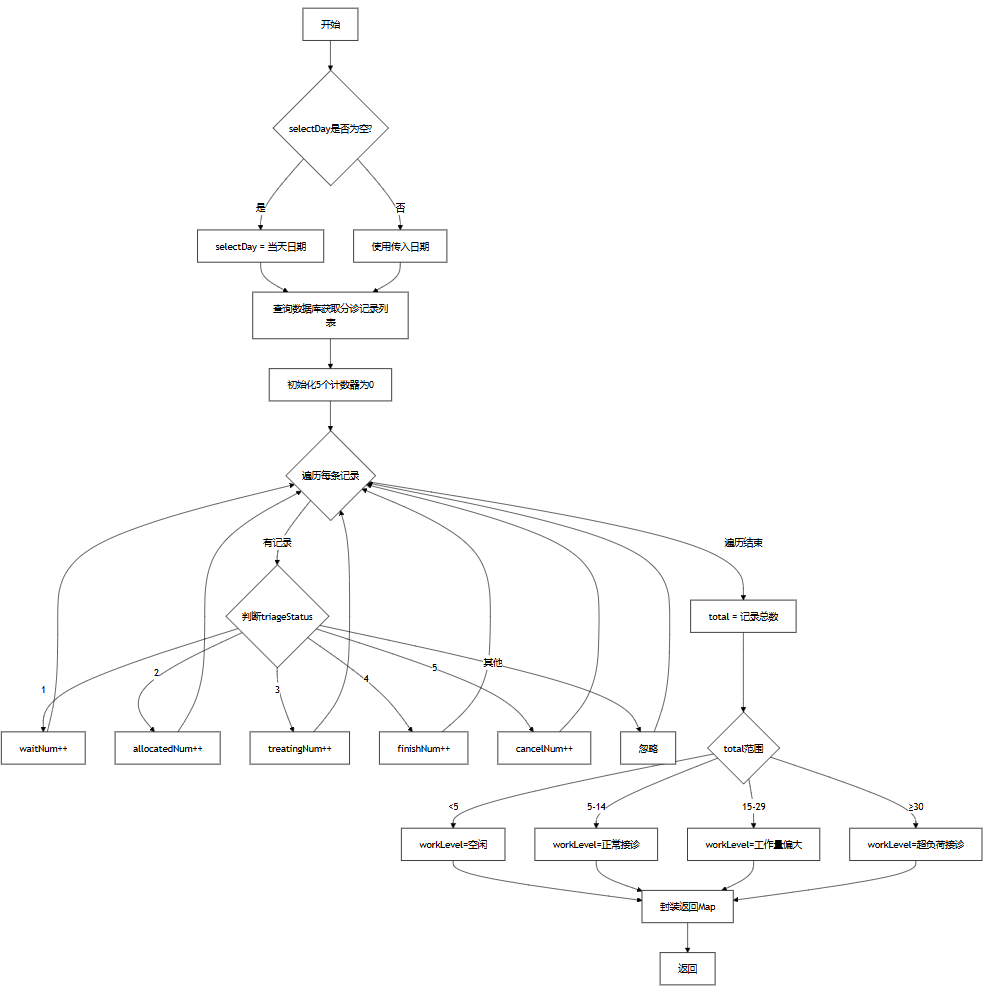

### 1.1 测试用例（4 条）

<div style="overflow-x:auto;">

| 用例编号 | doctorId | selectDate | 模拟数据（记录数 & status 分布） | 覆盖的语句 / 分支 |
|---|---|---|---|---|
| 1 | 1 | null | 1 条记录，status=1 | ① 日期 if 条件成立，自动赋值当日日期；② switch case1 执行；③ total=1，进入 total<5 → 空闲分支 |
| 2 | 1 | "2026-06-01" | 10 条记录，status=2 | ① 日期 if 不成立，使用传入日期；② switch case2 执行；③ total=10，进入 5≤total<15 → 正常接诊分支 |
| 3 | 1 | "2026-06-02" | 20 条记录，status=3 | ① switch case3 执行；② total=20，进入 15≤total<30 → 工作量偏大分支 |
| 4 | 1 | "2026-06-03" | 30 条记录：1 条 status=4、1 条 status=5、1 条 status=0（异常值） | ① switch case4、case5、default 分支全部执行；② total=30，进入 else → 超负荷接诊分支 |

</div>

> 语句覆盖的局限：4 条用例虽然让每条语句都跑过了，但**无法发现「把 `total < 5` 写成 `total <= 5`」这类判定内部的错误**，因此下面继续做判定覆盖。

---

## 2. 判定覆盖  `/doctor/update`

**测试思路**：判定覆盖（分支覆盖）要求每个判定表达式**取真、取假两种结果都至少执行一次**。该接口为医生信息更新，代码中存在两层 if 判定，共 2 条判定，因此最少 2 条用例即可满足，实际设计 3 条以覆盖嵌套结构。

**被测代码结构**：

```java
public Result<?> updateDoctor(DoctorDTO dto) {
    if (dto.getDocId() == null || dto.getDocId() <= 0) {   // 判定 D1
        throw new BizException("医生 ID 非法");
    }
    if (dto.getJobLevel() < 1 || dto.getJobLevel() > 3) {  // 判定 D2
        throw new BizException("职称等级错误，范围 1-3");
    }
    doctorMapper.updateById(dto);
    return Result.success("修改成功");
}
```

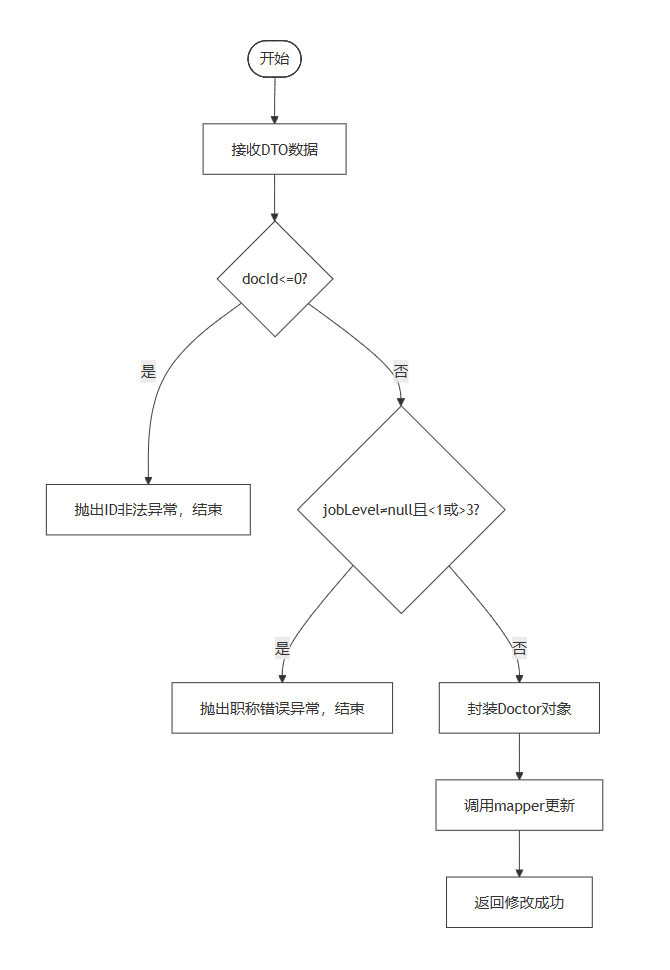

### 2.1 测试用例（3 条）

<div style="overflow-x:auto;">

| 用例编号 | docId | jobLevel | 运行结果 | 覆盖内容 |
|---|---|---|---|---|
| 1 | -5 | 2 | 抛出 ID 非法异常 | 判定 D1：true |
| 2 | 10 | 4 | 抛出职称错误异常 | 判定 D1：false；判定 D2：true |
| 3 | 10 | 2 | 修改成功 | 判定 D1：false；判定 D2：false |

</div>

> 判定覆盖的局限：`docId == null || docId <= 0` 是一个「或」复合判定，用例 1 只让 `docId <= 0` 为真，**`docId == null` 这个子条件从未取真过**，所以还需要条件覆盖。

---

## 3. 条件覆盖  `/doctor/page`

**测试思路**：条件覆盖要求判定里**每一个子条件的 true / false 都被覆盖到**。医生分页查询接口中存在「姓名是否传」「姓名是否为空串」「职称是否传」等多个子条件，单独为每个子条件设计取值。

**被测代码结构**：

```java
public Result<Page<DoctorVO>> page(String docName, Integer jobLevel) {
    boolean nameValid  = (docName != null);          // 条件 C1
    boolean nameBlank  = (docName != null && docName.trim().isEmpty()); // 条件 C2
    boolean levelValid = (jobLevel != null);         // 条件 C3
    ...
}
```


### 3.1 测试用例（3 条）

<div style="overflow-x:auto;">

| 用例编号 | docName | jobLevel | 条件取值 | 预期结果 |
|---|---|---|---|---|
| 1 | null | null | C1=F，C3=F | 不加任何筛选条件，返回全量分页数据 |
| 2 | "王医生" | 2 | C1=T，C2=F，C3=T | 按姓名 + 职称筛选分页 |
| 3 | ""（空串） | 1 | C1=T，C2=T，C3=T | 姓名为空视为不筛选，按职称筛选分页 |

</div>

> 条件覆盖会让每个子条件都取到真假，但**不能保证判定结果的真假**——例如可能所有用例都落进了同一分支，所以需要更强的判定-条件覆盖。

---

## 4. 判定-条件覆盖  `/patient/update`

**测试思路**：判定-条件覆盖 = 判定覆盖 + 条件覆盖，既要每个判定取真取假，又要判定内部每个子条件取真取假。患者信息更新接口含 2 个判定、3 个子条件，设计 4 条用例同时满足两种覆盖。

**被测代码结构**：

```java
public Result<?> updatePatient(PatientDTO dto) {
    if (dto.getPatId() == null || dto.getPatId() <= 0) {               // 判定 P1（C1、C2）
        throw new BizException("患者 ID 错误");
    }
    if (dto.getIdCard() != null && !IdCardUtil.isValid(dto.getIdCard())) { // 判定 P2（C3）
        throw new BizException("身份证格式错误");
    }
    patientMapper.updateById(dto);
    return Result.success("修改成功");
}
```

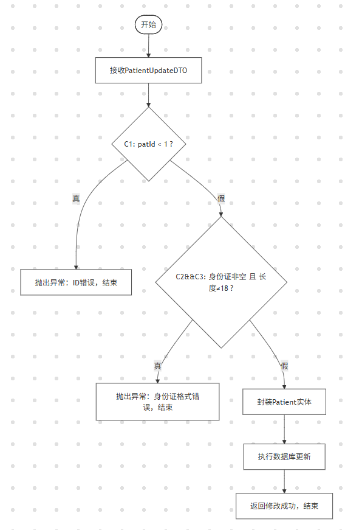

### 4.1 测试用例（4 条）

<div style="overflow-x:auto;">

| 用例编号 | patId | idCard | 条件取值 | 判定结果 | 执行结果 | JSON 请求参数 |
|---|---|---|---|---|---|---|
| 1 | 0 | null | C1=T；C2、C3 不执行 | P1=T | 抛出异常：ID 错误 | `{"patId":0,"patName":"张三","idCard":null}` |
| 2 | 10 | "123456" | C1=F；C2=T，C3=T | P1=F，P2=T | 抛出异常：身份证格式错误 | `{"patId":10,"patName":"李四","idCard":"123456"}` |
| 3 | 20 | null | C1=F；C2=F，C3 不执行 | P1=F，P2=F | 修改成功 | `{"patId":20,"patName":"王五","idCard":null}` |
| 4 | 30 | "110101199001011234" | C1=F；C2=T，C3=F | P1=F，P2=F | 修改成功 | `{"patId":30,"patName":"赵六","idCard":"110101199001011234"}` |

</div>

> 说明：用例 1 让 `patId == null` 路径（C1=T）被覆盖，用例 2~4 让 `patId <= 0`（C2）与 `patId 合法`（C2=F）都被覆盖，身份证条件的真 / 假也各有对应用例。

---

## 5. 条件组合覆盖  `/patient/delete`

**测试思路**：条件组合覆盖要求判定内**所有子条件的真假排列组合**全部覆盖，强度高于判定-条件覆盖。患者删除接口有两个子条件，共需覆盖 2² = 4 种组合。

**被测代码结构**：

```java
public Result<?> deletePatient(Integer patId, Integer hasTriage) {
    if (patId == null || patId <= 0) {        // C1
        throw new BizException("患者编号无效");
    }
    if (hasTriage == 1) {                     // C2
        throw new BizException("已产生分诊数据，不能删除");
    }
    patientMapper.deleteById(patId);
    return Result.success("删除成功");
}
```

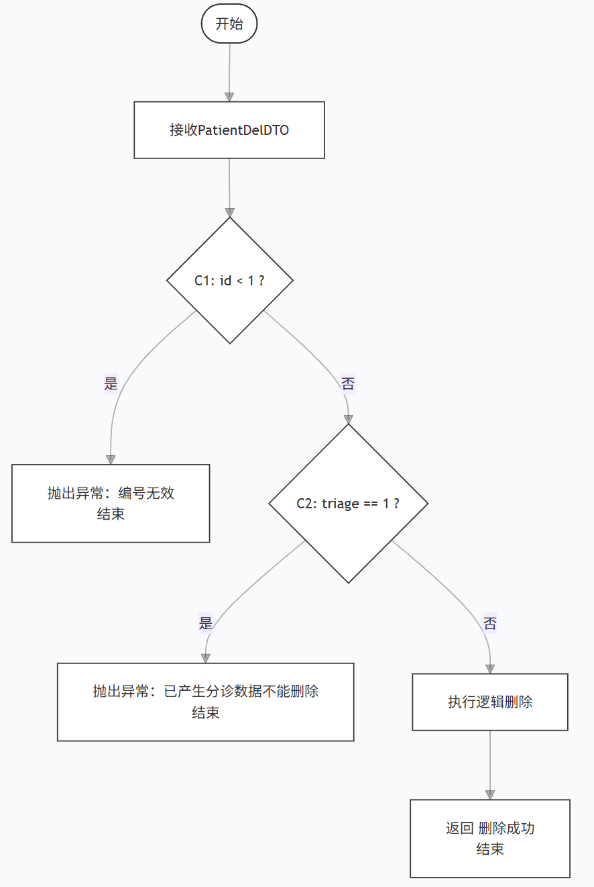

### 5.1 测试用例（4 条）

<div style="overflow-x:auto;">

| 用例编号 | id | triage | 条件组合 | 执行结果 | JSON 参数 |
|---|---|---|---|---|---|
| 1 | 0 | 1 | C1=T，C2=T | 抛出异常：编号无效 | `{"patId":0,"hasTriage":1}` |
| 2 | 0 | 0 | C1=T，C2=F | 抛出异常：编号无效 | `{"patId":0,"hasTriage":0}` |
| 3 | 5 | 1 | C1=F，C2=T | 抛出异常：已产生分诊数据不能删除 | `{"patId":5,"hasTriage":1}` |
| 4 | 5 | 0 | C1=F，C2=F | 删除成功 | `{"patId":5,"hasTriage":0}` |

</div>

---

## 6. 基本路径测试法  `/dept/update`

**测试思路**：基本路径测试先画控制流图，再计算**环形复杂度 V(G)**，得到独立路径条数，然后为每条独立路径设计一条用例，保证每条路径至少被执行一次。

**被测代码结构**：

```java
public Result<?> updateDept(DeptDTO dto) {
    if (dto.getDeptId() == null || dto.getDeptId() <= 0) {        // 判定 A
        throw new BizException("科室 ID 非法");
    }
    if (dto.getDeptName().length() < 2) {                        // 判定 B
        throw new BizException("科室名称太短");
    }
    if (dto.getDeptType() != 1 && dto.getDeptType() != 2) {       // 判定 C
        throw new BizException("科室类型错误");
    }
    deptMapper.updateById(dto);
    return Result.success("修改成功");
}
```

**环形复杂度计算**：

| 计算方式 | 结果 |
|---|---|
| 判定节点数 + 1 | 3 + 1 = 4 |
| 边数 − 节点数 + 2 | 9 − 7 + 2 = 4 |
| 区域数 | 4 |

> V(G) = 4，说明共有 **4 条独立路径**，至少需要 4 条用例。

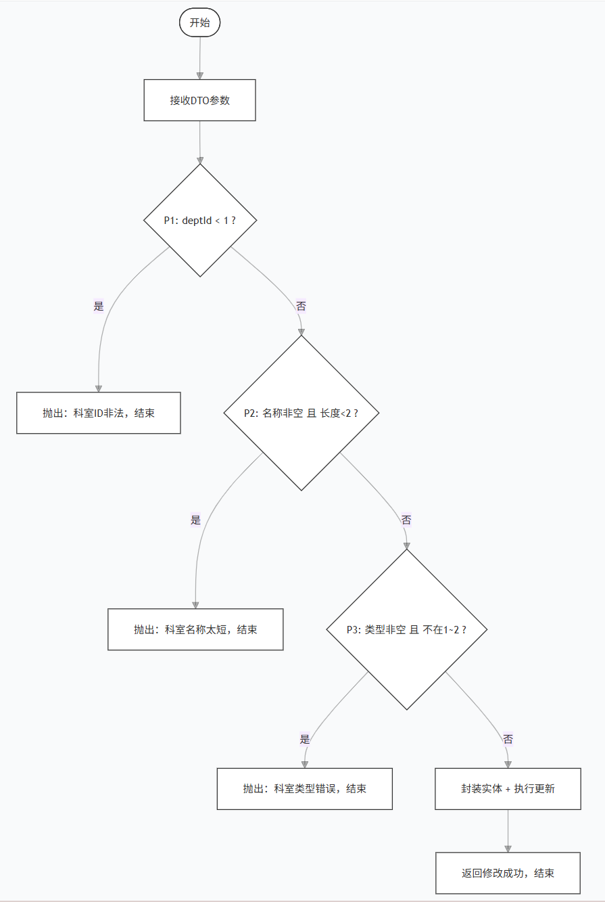

### 6.1 独立路径与测试用例（4 条）

| 路径编号 | 路径描述 | 对应判定走向 |
|---|---|---|
| P1 | 起点 → A(真) → 抛出异常 → 终点 | A 真 |
| P2 | 起点 → A(假) → B(真) → 抛出异常 → 终点 | A 假、B 真 |
| P3 | 起点 → A(假) → B(假) → C(真) → 抛出异常 → 终点 | A 假、B 假、C 真 |
| P4 | 起点 → A(假) → B(假) → C(假) → 更新 → 终点 | A 假、B 假、C 假 |

<div style="overflow-x:auto;">

| 用例编号 | deptId | deptName | deptType | 执行路径 | 执行结果 | JSON 请求参数 |
|---|---|---|---|---|---|---|
| TC1 | 0 | "内科" | 1 | P1 | 抛出：科室 ID 非法 | `{"deptId":0,"deptName":"内科","deptType":1}` |
| TC2 | 10 | "A" | 1 | P2 | 抛出：科室名称太短 | `{"deptId":10,"deptName":"A","deptType":1}` |
| TC3 | 10 | "外科" | 3 | P3 | 抛出：科室类型错误 | `{"deptId":10,"deptName":"外科","deptType":3}` |
| TC4 | 10 | "急诊科" | 2 | P4 | 修改成功 | `{"deptId":10,"deptName":"急诊科","deptType":2}` |

</div>

---

## 7. 目标代码插桩  `/dept/page`

**测试思路**：目标代码插桩是在代码关键分支处插入日志语句（桩），程序运行后通过**控制台日志输出**判断代码实际走了哪一条分支，用于验证分支逻辑与用例设计一致、排查未覆盖代码。

**插桩示例**：

```java
public Result<Page<DeptVO>> page(String deptName) {
    System.out.println("[桩] 进入 page 方法，deptName = " + deptName);
    if (deptName != null && !deptName.trim().isEmpty()) {
        System.out.println("[桩] 进入姓名筛选分支");
        ...
    } else {
        System.out.println("[桩] 未进入姓名筛选分支，走全量查询");
    }
}
```

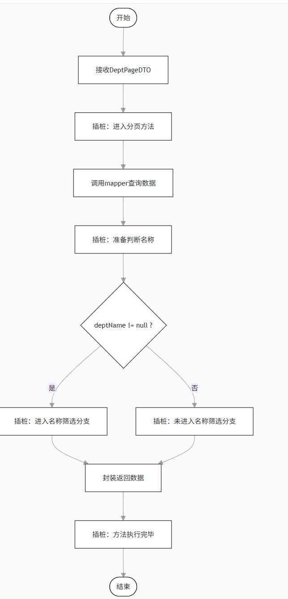

**控制台日志截图**：

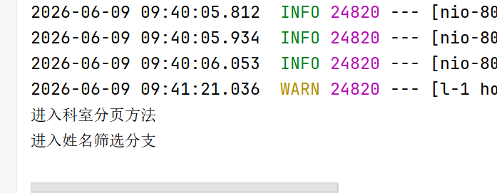

### 7.1 测试用例（2 条）

<div style="overflow-x:auto;">

| 用例编号 | deptName | 执行分支 | 控制台插桩输出核心内容 | JSON 参数 |
|---|---|---|---|---|
| 1 | "内科" | deptName != null = 真 | [桩] 进入姓名筛选分支 | `{"deptName":"内科"}` |
| 2 | null | deptName != null = 假 | [桩] 未进入姓名筛选分支 | `{"deptName":null}` |

</div>

---

## 8. JUnit 单元测试（手写 Mock）— 科室删除业务

**测试思路**：针对 Service 层做单元测试，**手写 Mock Mapper 对象模拟数据库层**，不连接真实 MySQL，隔离外部依赖，只验证业务代码逻辑分支是否正确。

**为什么用 Mock**：若直接连真实数据库，测试结果会受库中数据、环境、并发影响，且单元测试会污染真实数据；用假 Mapper 返回预设值，测试可重复、稳定，还能方便构造「查不到数据」「主键冲突」这类难以在真实库中复现的场景。

**被测代码结构**：

```java
@Service
public class DeptServiceImpl implements DeptService {

    @Resource
    private DeptMapper deptMapper;

    @Override
    public Result<?> deleteDept(Integer deptId) {
        if (deptId == null || deptId <= 0) {                 // 判定
            throw new BizException("删除 ID 错误");
        }
        deptMapper.deleteById(deptId);
        return Result.success("删除成功");
    }
}
```

**手写 Mock 实现要点**：

```java
// 手写假 Mapper，不依赖 MyBatis、不依赖数据库
class MockDeptMapper implements DeptMapper {
    private int deletedId;

    @Override
    public int deleteById(Integer id) {
        this.deletedId = id;   // 只记录被删除的 ID，不真正落库
        return 1;
    }
}
```

**单元测试类**：

```java
public class DeptServiceImplTest {

    @Test
    public void testDeleteDept_idInvalid() {
        DeptServiceImpl service = new DeptServiceImpl();
        // 注入手写 Mock
        service.deptMapper = new MockDeptMapper();
        // 分支：deptId < 1 为 true
        assertThrows(BizException.class, () -> service.deleteDept(0));
    }

    @Test
    public void testDeleteDept_success() {
        DeptServiceImpl service = new DeptServiceImpl();
        service.deptMapper = new MockDeptMapper();
        // 分支：deptId < 1 为 false，正常删除
        Result<?> result = service.deleteDept(10);
        assertEquals("删除成功", result.getMsg());
    }
}
```

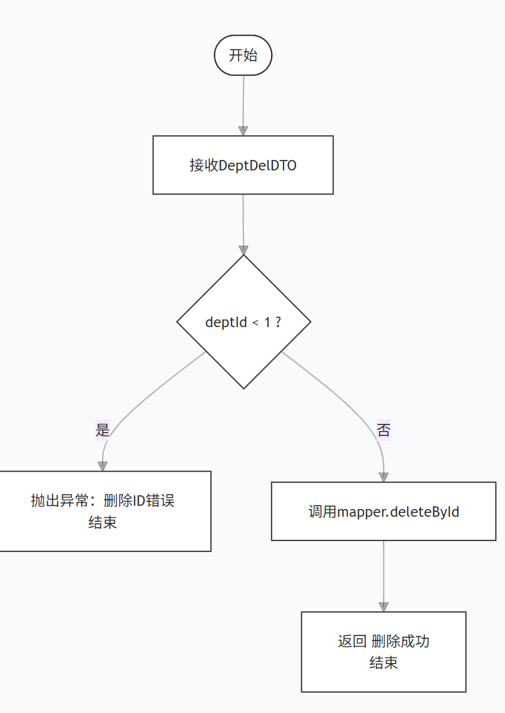

**JUnit 代码与运行结果**：

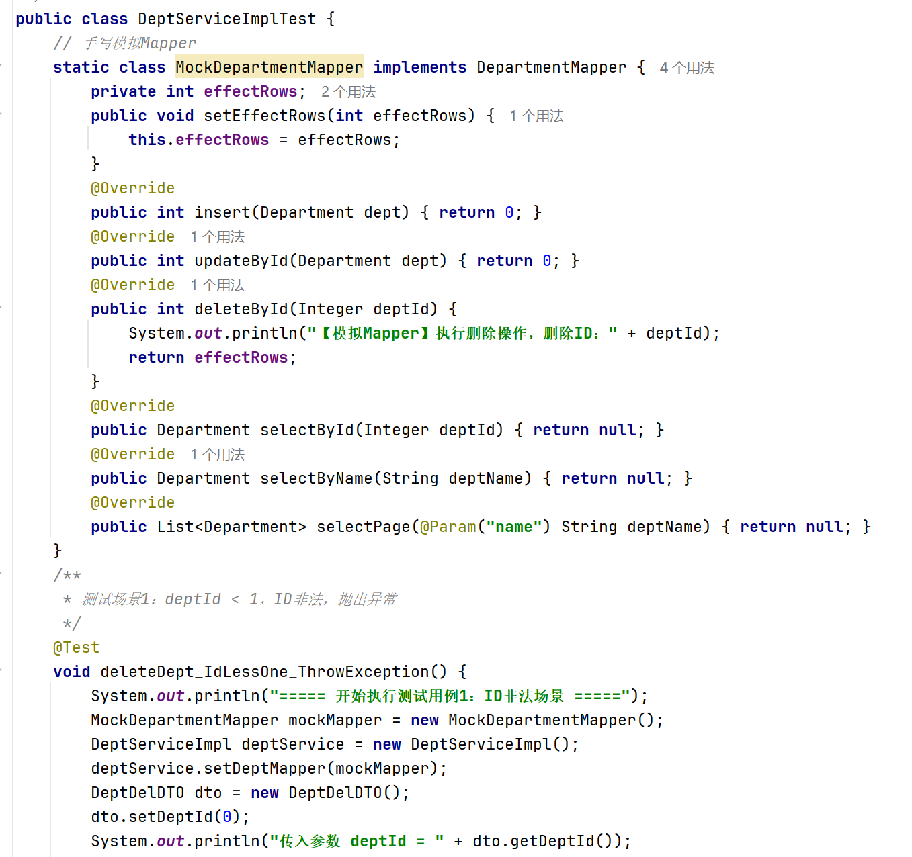

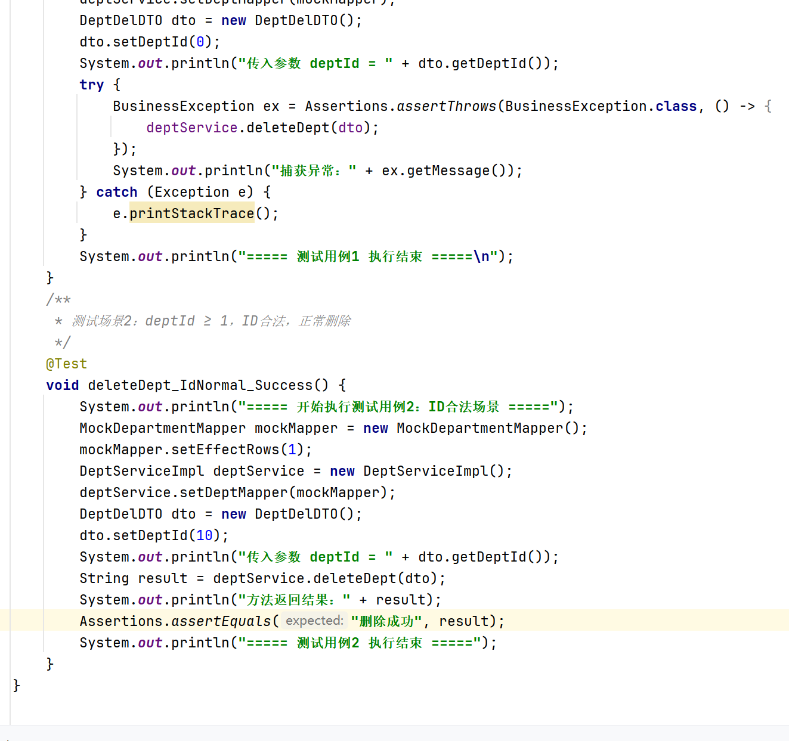

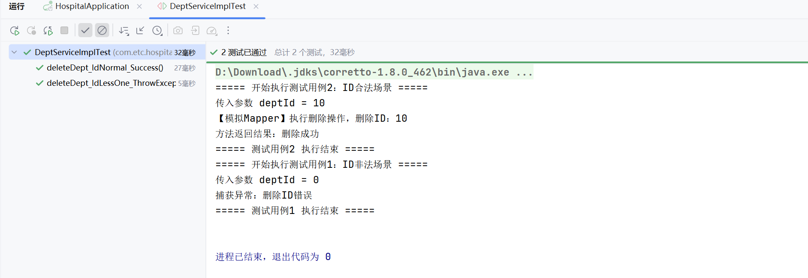

### 8.1 测试用例（2 条）

<div style="overflow-x:auto;">

| 用例编号 | deptId | 输入参数 | 执行分支 | 预期结果 |
|---|---|---|---|---|
| 1 | 0 | `{"deptId":0}` | deptId < 1 为 true | 抛出异常：删除 ID 错误 |
| 2 | 10 | `{"deptId":10}` | deptId < 1 为 false | 返回：删除成功 |

</div>

### 8.2 目录规范说明

| 目录 | 作用 | 打包 |
|---|---|---|
| `src/main/java` | 业务正式代码 | 会打进 jar，部署上线 |
| `src/test/java` | 单元测试代码（JUnit） | 不参与打包，`mvn test` 时才会执行 |

> 本单元测试类放在 `src/test/java` 下，符合 Maven 约定：既不会被 `mvn test` 漏扫，也不会污染生产 jar 包。
> 截图中的 `DeptServiceImplTest.java` 若曾放在 `src/main/java`，需要移动到 `src/test/java`，否则 `mvn test` 不会自动执行，且测试代码会被打进生产包。

---

## 小结

| 覆盖方法 | 用例数 | 覆盖面 | 发现能力 |
|---|---|---|---|
| 语句覆盖 | 4 | 每条可执行语句执行一次 | 最弱，无法发现判定内部错误 |
| 判定覆盖 | 3 | 每个判定取真 / 假 | 能发现分支缺失，无法发现复合条件错误 |
| 条件覆盖 | 3 | 每个子条件取真 / 假 | 能发现子条件遗漏，但不保证判定结果 |
| 判定-条件覆盖 | 4 | 判定真假 + 子条件真假 | 兼顾两者，强度较高 |
| 条件组合覆盖 | 4 | 子条件全部真假组合 | 强度高，能发现组合型逻辑错误 |
| 基本路径测试 | 4 | 全部独立路径（V(G)=4） | 保证每条路径被执行 |
| 目标代码插桩 | 2 | 实际运行分支 | 验证用例是否真正走到目标分支 |
| JUnit + Mock | 2 | Service 业务分支 | 隔离数据库，稳定可重复执行 |

**结论**：8 种白盒方法层层递进，从「每行跑一次」到「每个组合都跑一次」，配合手写 Mock 单元测试隔离数据库，能在不启动完整环境的前提下验证业务逻辑，补足黑盒测试只能看外部输入、看不到内部分支的盲区。
