# 专项测试

> 项目：医院管理系统（后台接口）
测试范围：错误分析法（缺陷定位与修复）、Postman 接口测试、JMeter 性能压测
说明：黑盒、白盒测试主要验证「功能是否正确」，专项测试进一步从**异常容错、接口契约、并发承载**三个维度评估系统质量。

***

## 1. 错误分析法  `/patient/search`

**测试思路**：错误分析法是从「最容易出错、最容易被忽略」的位置入手，主动构造异常输入、观察程序是否会崩溃。本次在患者查询接口中人为植入一处空指针缺陷，完整走一遍「定位缺陷 → 复现 → 分析根因 → 修复 → 回归验证」的流程。

### 1.1 缺陷代码（修复前）

**Controller 层**：拿到 Service 返回值后未做非空判断，直接调用 `get()`。

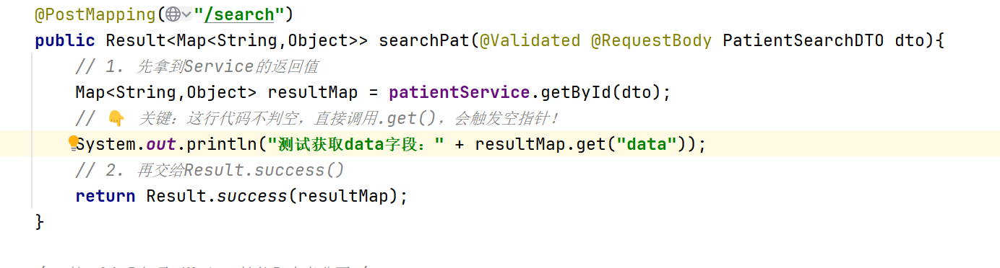

**Service 层**：当 `patId > 9999` 时直接 `return null`，返回空对象。

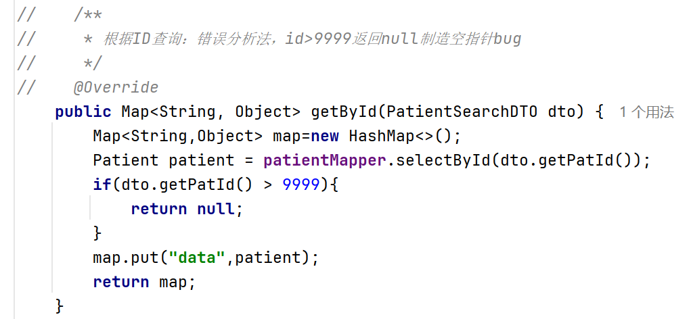

### 1.2 缺陷根因分析

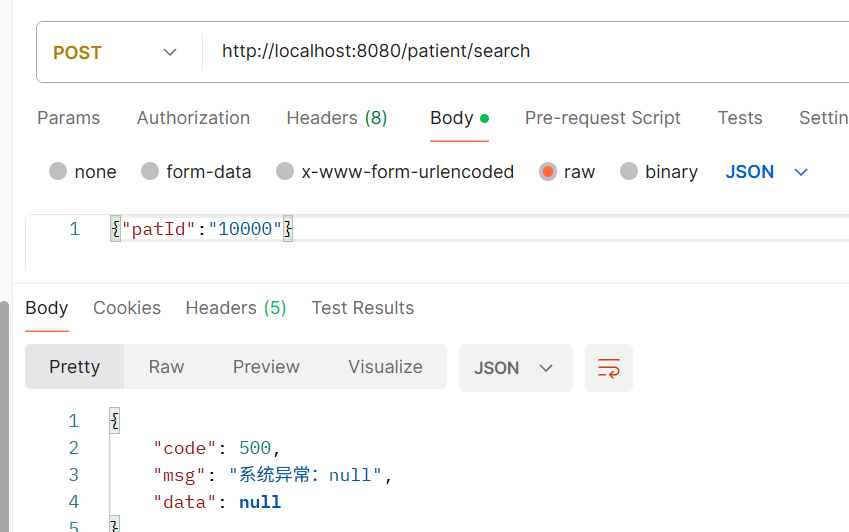

- **触发条件**：`patId > 9999`（数据库中不存在的患者 ID）。
- **根因**：Service 在该分支返回 `null`；Controller 中未做非空判断，直接执行 `resultMap.get("data")`，对 `null` 调用方法触发 `NullPointerException`。
- **影响**：接口直接抛 500 空指针异常，前端无法拿到统一的错误提示，属于高危异常容错缺陷。

### 1.3 修复前运行结果

控制台抛出 `java.lang.NullPointerException`，堆栈定位到 `PatientController.searchPat` 第 45 行。

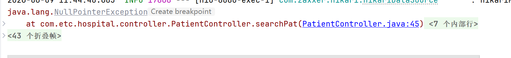

### 1.4 修复方案

修改 Service 代码：无论是否查到数据，**都返回非空 Map 对象**；查不到时把 `data` 置为 `null`，由上层统一封装返回。

**Service 修复后代码**：

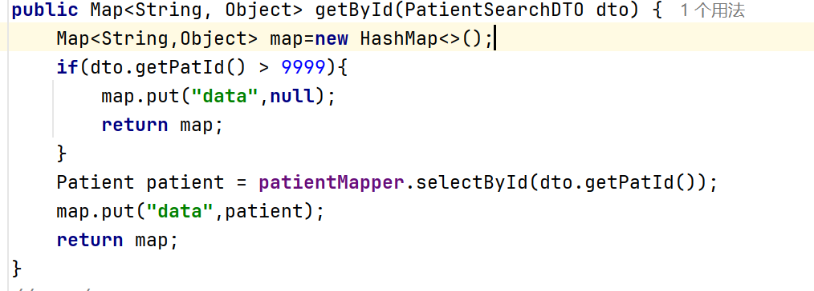

### 1.5 修复后运行结果

再次传入不存在的患者 ID，接口不再抛空指针，正常返回「data 字段为 null」的结果，流程闭环。

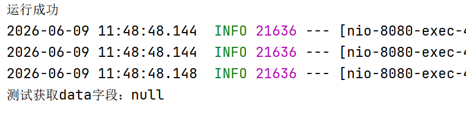

***

## 2. 接口测试（Postman）  `/doctor/cancel`

**测试思路**：接口测试不经过前端页面，直接调用后端 HTTP 接口，验证请求参数、响应结构、业务提示与状态码是否符合接口契约。本次使用 Postman 对医生停诊接口做正常 + 异常两类场景验证，并结合 Swagger 接口文档核对响应报文。

### 2.1 被测接口

- **请求方式**：`POST`
- **接口地址**：[`http://localhost:8080/doctor/cancel`](http://localhost:8080/doctor/cancel)
- **请求体**：JSON，字段 `docId`（医生 ID）、`status`（停诊状态）

### 2.2 Postman 请求与响应

**正常场景请求**：

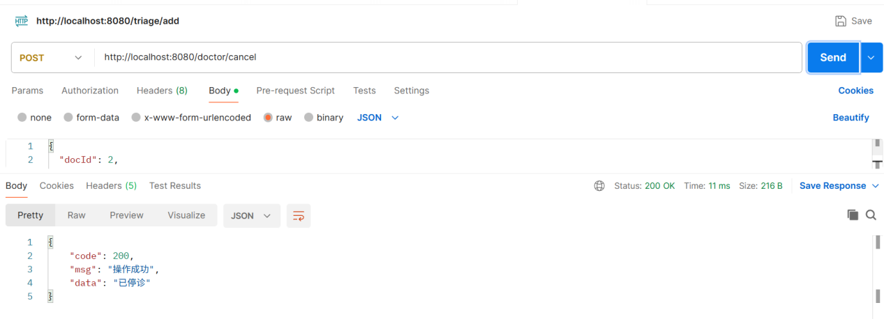

**接口响应结果**：

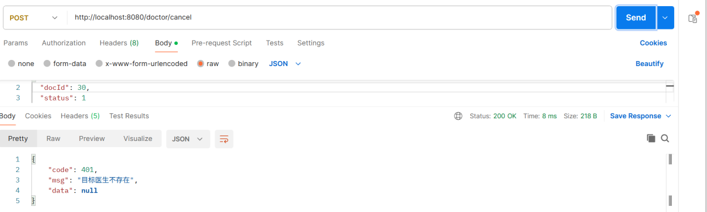

### 2.3 接口测试用例（2 条）

| 用例编号 | 测试场景 | 请求参数 JSON | 预期结果 | 实际结果（Swagger 响应） | 状态码 | 测试结果 |
| --- | --- | --- | --- | --- | --- | --- |
| 1 | 正常场景（存在的医生 ID） | `{"docId":1,"status":1}` | 操作成功，返回已停诊提示 | `{"code":200,"msg":"操作成功","data":"已停诊"}` | 200 | ✅ 通过 |
| 2 | 异常场景（不存在的医生 ID） | `{"docId":30,"status":1}` | 提示目标医生不存在 | `{"code":401,"msg":"目标医生不存在","data":null}` | 200 | ✅ 通过（异常处理正确） |

### 2.4 Swagger 接口报告

**接口定义与请求示例**：

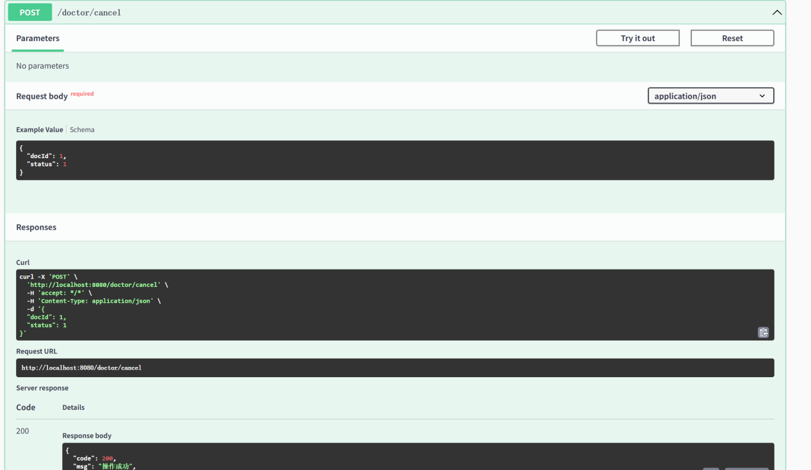

**接口响应核对**：

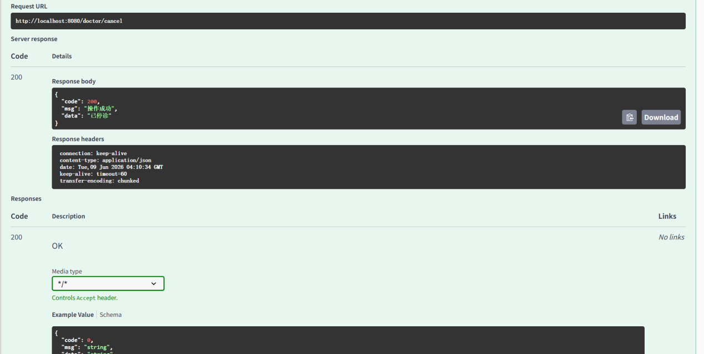

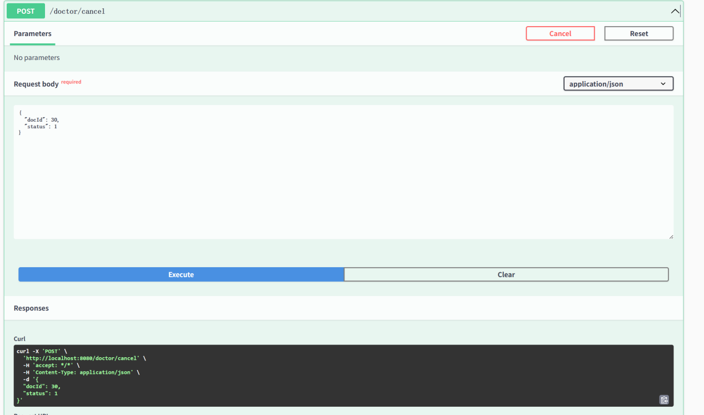

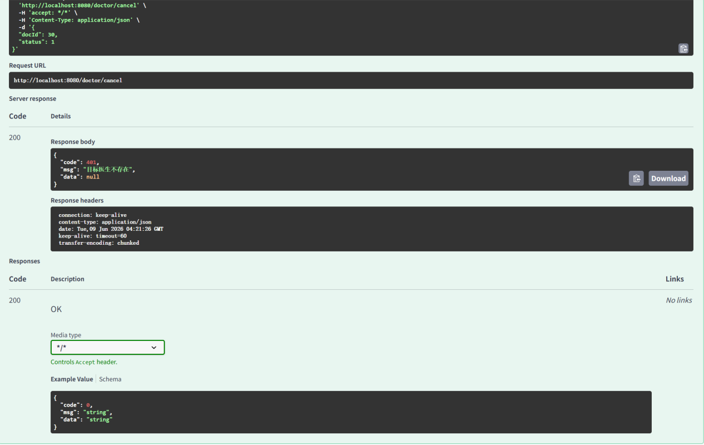

> 观察记录：用例 2 业务返回码为 `401`（目标医生不存在），但 HTTP 状态码仍为 `200`。这是后端「统一异常封装」的常见做法——HTTP 层表示请求到达并被正常处理，业务结果由响应体中的 `code` 字段区分；该现象已记入缺陷清单待评估是否需要统一规范。

***

## 3. 性能测试（JMeter）  `/patient/page`

**测试思路**：使用 JMeter 模拟多用户并发请求患者分页查询接口，统计响应时间、吞吐量、错误率等指标，验证接口在并发压力下的承载能力与稳定性。

### 3.1 测试环境与压测配置

- **被测接口**：`POST `[`http://localhost:8080/patient/page`](http://localhost:8080/patient/page)
- **请求体**：`{"patName": ""}`（空姓名，全量分页查询）
- **压测工具**：Apache JMeter 5.6.3

**线程组（并发用户）配置**：

| 配置项 | 取值 | 说明 |
| --- | --- | --- |
| Number of Threads（用户数） | 5 | 模拟 5 个并发用户 |
| Ramp-up period（秒） | 5 | 5 秒内逐步启动全部线程 |
| Loop Count | Infinite | 循环次数不限 |
| Specify Thread lifetime | 勾选 | 限制压测持续时间 |
| Duration（秒） | 5 | 压测持续 5 秒 |

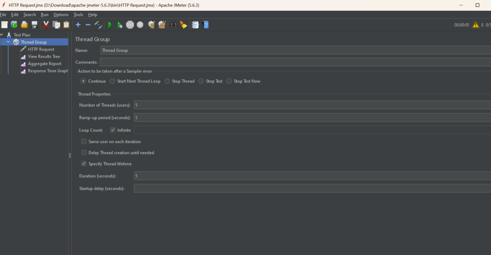

**HTTP 请求配置**：

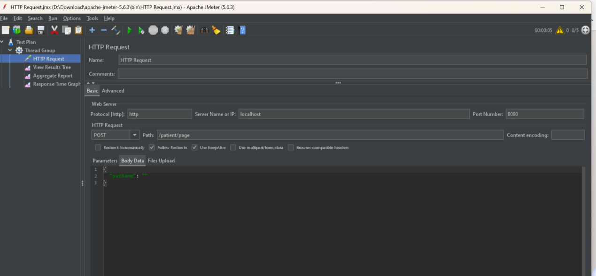

### 3.2 压测执行结果

**查看结果树（View Results Tree）**：所有请求均为绿色通过，无报错样本。

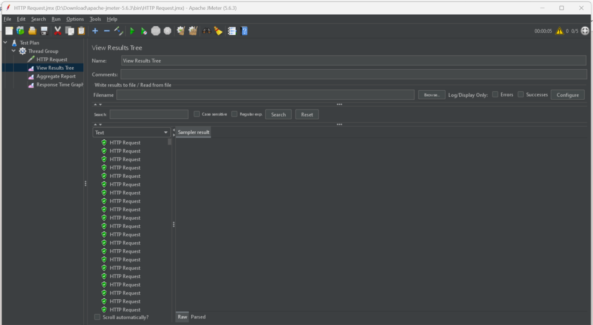

**聚合报告（Aggregate Report）**：

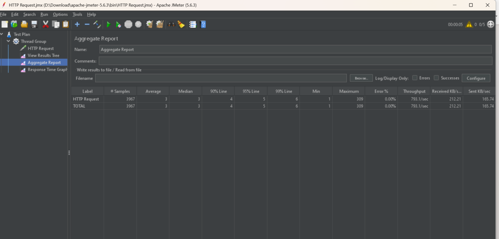

| 指标 | 数值 | 含义 |
| --- | --- | --- |
| # Samples（样本数） | 3967 | 5 秒内共发出 3967 个请求 |
| Average（平均响应时间） | 3 ms | 平均每个请求耗时 3 毫秒 |
| Median（中位数） | 3 ms | 50% 请求在 3 ms 内返回 |
| 90% Line | 4 ms | 90% 请求在 4 ms 内返回 |
| 95% Line | 5 ms | 95% 请求在 5 ms 内返回 |
| 99% Line | 6 ms | 99% 请求在 6 ms 内返回 |
| Min（最小） | 1 ms | 最快请求 1 毫秒 |
| Maximum（最大） | 309 ms | 最慢请求 309 毫秒 |
| Error %（错误率） | 0.00% | 无失败请求 |
| Throughput（吞吐量） | 793.1/sec | 每秒处理 793.1 个请求 |
| Received KB/s | 212.21 | 每秒接收 212.21 KB |
| Sent KB/s | 165.74 | 每秒发送 165.74 KB |

**响应时间图（Response Time Graph）**：

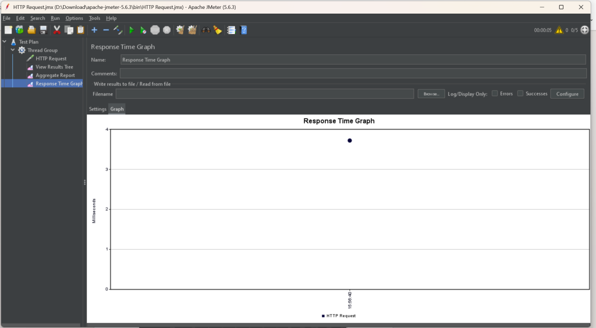

### 3.3 结果分析

1. **错误率 0%**：5 秒并发压测期间无请求失败，接口稳定性达标。
2. **响应时间整体良好**：平均 3 ms、99% 请求在 6 ms 内返回，分页查询接口性能满足实训系统要求。
3. **存在个别慢请求**：最大响应时间 309 ms，与平均水平差距较大，属于偶发抖动（可能与首次查询、连接池初始化、GC 有关），已记入缺陷清单作为观察项，建议后续增加样本量复测。
4. **吞吐量 793.1/sec**：在 5 并发用户下接口吞吐表现正常；当前并发量较小，后续可逐步加大线程数做阶梯压测，找到接口的性能拐点。

***

## 4. 专项测试小结

| 专项类型 | 工具 / 方法 | 被测接口 | 结论 |
| --- | --- | --- | --- |
| 错误分析法 | 人工植入缺陷 + 代码排查 | `/patient/search` | 定位空指针根因，修复后回归通过 |
| 接口测试 | Postman + Swagger | `/doctor/cancel` | 正常 / 异常场景响应符合契约，2 条用例全部通过 |
| 性能测试 | JMeter 5.6.3 | `/patient/page` | 3967 样本、错误率 0%、平均 3 ms，接口稳定；个别慢请求待复测 |

**整体结论**：专项测试从异常容错、接口契约、并发承载三个维度补充了黑盒与白盒测试的覆盖盲区；发现的空指针缺陷已修复闭环，性能指标满足实训系统要求，遗留观察项已纳入缺陷清单跟踪。
