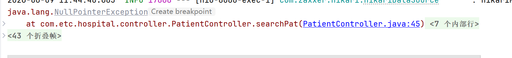
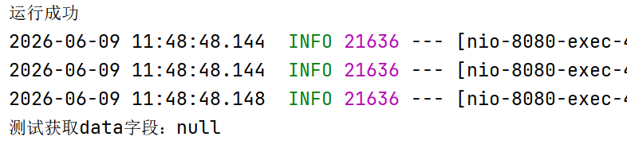

# 缺陷记录清单

> 项目：医院管理系统（后台接口）
> 用途：汇总测试过程中发现的全部缺陷，记录缺陷等级、优先级、复现步骤与修复状态，跟踪缺陷闭环。
> 说明：本清单与黑盒、白盒、专项测试用例一一对应；每条缺陷均包含可复现的前置条件、操作步骤、预期 / 实际结果，方便开发定位与回归验证。

---

## 1. 缺陷分级与状态定义

### 1.1 缺陷严重等级（Severity）

| 等级 | 名称 | 定义 | 示例 |
|---|---|---|---|
| S1 | 致命 | 系统崩溃、数据丢失 / 错乱、主流程完全不可用，或存在安全漏洞 | 删库、数据库宕机、登录接口不可用 |
| S2 | 严重 | 核心功能报错阻塞业务、抛出未捕获异常、主流程无法走完 | 空指针 500、核心接口无响应 |
| S3 | 一般 | 功能结果错误但有绕过方式，或提示文案、状态码、返回结构不规范 | 错误码与 HTTP 状态码不一致、提示文案不准确 |
| S4 | 轻微 | 界面显示、体验细节、建议类优化，不影响主流程 | 文案错别字、排版错位、偶发慢请求 |

### 1.2 缺陷优先级（Priority）

| 优先级 | 处理要求 |
|---|---|
| 高（P1） | 阻塞主流程，必须在当前版本修复，优先安排 |
| 中（P2） | 功能或规范问题，本版本内修复 |
| 低（P3） | 体验 / 观察类问题，可排期后续优化 |

### 1.3 缺陷状态流转

```
新建 → 已确认 → 修复中 → 待回归 → 已关闭
                          ↓
                      回归不通过 → 重新打开
```

| 状态 | 含义 |
|---|---|
| 新建 | 测试人员提交缺陷，尚未分诊 |
| 已确认 | 开发 / 负责人确认缺陷属实，归入修复排期 |
| 修复中 | 开发正在修改代码 |
| 待回归 | 开发已提交修复，等待测试复测 |
| 已关闭 | 回归通过，缺陷闭环 |
| 重新打开 | 回归未通过，退回开发继续修复 |

---

## 2. 缺陷报告单模板

每条缺陷按以下结构填写，便于开发复现与测试回归：

<div style="overflow-x:auto;">

| 字段 | 填写说明 |
|---|---|
| 缺陷编号 | BUG-XXX，全文档唯一 |
| 所属模块 | 患者 / 分诊 / 医生 / 科室等 |
| 被测接口 | 请求方式 + 接口地址 |
| 缺陷标题 | 一句话概括问题，如「患者查询不存在 ID 时抛空指针」 |
| 严重等级 | S1 / S2 / S3 / S4 |
| 优先级 | P1 / P2 / P3 |
| 前置条件 | 复现所需的数据、环境、账号等 |
| 复现步骤 | 编号列出每一步操作 |
| 预期结果 | 依据需求 / 接口文档应该返回的结果 |
| 实际结果 | 实际观察到的报错 / 错误数据 / 异常截图 |
| 缺陷根因 | 代码层面的原因分析 |
| 修复方案 | 开发采取的修改措施 |
| 回归结果 | 复测是否通过、当前状态 |
| 附件 | 截图、日志、录屏，存放于 `assets/` |

</div>

---

## 3. 缺陷清单总表

<div style="overflow-x:auto;">

| 缺陷编号 | 所属模块 | 被测接口 | 缺陷标题 | 严重等级 | 优先级 | 状态 |
|---|---|---|---|---|---|---|
| BUG-001 | 患者查询 | `POST /patient/search` | 查询不存在的患者 ID 时触发空指针异常（NPE） | S2 严重 | P1 高 | 已关闭（回归通过） |
| BUG-002 | 医生管理 | `POST /doctor/cancel` | 业务错误码 401 与 HTTP 状态码 200 混用，返回结构不统一 | S3 一般 | P2 中 | 已确认（建议优化） |
| BUG-003 | 患者分页 | `POST /patient/page` | 并发压测下出现偶发慢请求，最大响应时间 309 ms | S4 轻微 | P3 低 | 观察项（待复测） |

</div>

---

## 4. 缺陷详情

### 4.1 BUG-001：患者查询不存在 ID 时触发空指针

| 字段 | 内容 |
|---|---|
| 缺陷编号 | BUG-001 |
| 所属模块 | 患者查询 |
| 被测接口 | `POST /patient/search` |
| 缺陷标题 | `patId > 9999` 时 Service 返回 null，Controller 未判空，触发 NullPointerException |
| 严重等级 | S2 严重 |
| 优先级 | P1 高 |
| 前置条件 | 数据库中不存在 `patId > 9999` 的患者记录；服务正常启动 |
| 复现步骤 | ① 调用 `/patient/search`，传入不存在的患者 ID；② 观察接口返回与控制台日志 |
| 预期结果 | 接口返回统一 Result 结构，提示「患者不存在」，不抛未捕获异常 |
| 实际结果 | Controller 直接对 null 调用 `get()`，抛出 `java.lang.NullPointerException`，接口返回 500 |
| 缺陷根因 | Service 在 `patId > 9999` 分支直接 `return null`；Controller 拿到返回值后未做非空判断即调用 `resultMap.get("data")` |
| 修复方案 | 修改 Service：任何分支都返回非空 Map；查不到数据时 `map.put("data", null)`，由上层统一封装返回 |
| 回归结果 | 复测通过：传入不存在 ID 时接口正常返回，data 为 null，无空指针；状态已关闭 |
| 附件 | `错误分析-Service原代码.png`、`错误分析-Controller原代码.png`、`错误分析-修复前NPE堆栈.png`、`错误分析-Service修复后代码.png`、`错误分析-Controller修复后代码.png`、`错误分析-修复后运行结果.png` |

**修复前代码缺陷**：

```java
// Service：不存在的患者直接返回 null
public Map<String, Object> getById(PatientSearchDTO dto) {
    Map<String, Object> map = new HashMap<>();
    Patient patient = patientMapper.selectById(dto.getPatId());
    if (dto.getPatId() > 9999) {
        return null;                 // ← 缺陷点：返回 null
    }
    map.put("data", patient);
    return map;
}

// Controller：未判空直接调用 get()
Map<String, Object> resultMap = patientService.getById(dto);
System.out.println("测试获取data字段：" + resultMap.get("data"));  // ← null.get() 抛 NPE
return Result.success(resultMap);
```

**修复后代码**：

```java
// Service：始终返回非空 Map，查不到时 data 置 null
public Map<String, Object> getById(PatientSearchDTO dto) {
    Map<String, Object> map = new HashMap<>();
    if (dto.getPatId() > 9999) {
        map.put("data", null);
        return map;
    }
    Patient patient = patientMapper.selectById(dto.getPatId());
    map.put("data", patient);
    return map;
}
```

**修复前 NPE 堆栈**：



**修复后运行结果**：



---

### 4.2 BUG-002：业务错误码与 HTTP 状态码混用

| 字段 | 内容 |
|---|---|
| 缺陷编号 | BUG-002 |
| 所属模块 | 医生管理 |
| 被测接口 | `POST /doctor/cancel` |
| 缺陷标题 | 业务失败时响应体 code=401，但 HTTP 状态码仍为 200，错误码与状态码口径不统一 |
| 严重等级 | S3 一般 |
| 优先级 | P2 中 |
| 前置条件 | 调用停诊接口，传入不存在的医生 ID（docId=30） |
| 复现步骤 | ① Postman 请求 `/doctor/cancel`，body：`{"docId":30,"status":1}`；② 查看 HTTP 状态码与响应体 code |
| 预期结果 | 接口对「业务失败」与「HTTP 层失败」的口径有统一约定，前端可按同一规则判断成功 / 失败 |
| 实际结果 | HTTP 状态码 200，响应体 `{"code":401,"msg":"目标医生不存在","data":null}` |
| 缺陷根因 | 后端采用「全局异常封装」：HTTP 层始终返回 200，业务结果由响应体 `code` 区分；缺少统一的错误码 / 状态码规范说明 |
| 修复方案（建议） | 与前后端约定统一规范：业务成功 code=200，业务失败按错误码体系返回；必要时对应调整 HTTP 状态码，或在接口文档中明确「以响应体 code 为准」 |
| 回归结果 | 已确认问题属实，列入优化排期；当前异常提示本身正确，不阻塞主流程 |
| 附件 | `Postman-医生停诊请求.png`、`Postman-医生停诊响应.png` |

> 说明：该缺陷不影响功能正确性，属于接口规范类问题；是否调整取决于项目约定，故定为一般等级。

---

### 4.3 BUG-003：并发压测偶发慢请求

| 字段 | 内容 |
|---|---|
| 缺陷编号 | BUG-003 |
| 所属模块 | 患者分页 |
| 被测接口 | `POST /patient/page` |
| 缺陷标题 | JMeter 5 并发压测中出现单次 309 ms 的慢请求，与平均 3 ms 差距较大 |
| 严重等级 | S4 轻微 |
| 优先级 | P3 低 |
| 前置条件 | JMeter 线程组：5 用户、Ramp-up 5 秒、持续 5 秒；接口 `{"patName":""}` |
| 复现步骤 | ① 配置线程组与 HTTP 请求；② 执行压测，查看聚合报告 Maximum 指标 |
| 预期结果 | 响应时间集中在合理区间，无明显长尾 |
| 实际结果 | 平均 3 ms、99% 线 6 ms，但 Maximum 达 309 ms，存在个别慢请求 |
| 缺陷根因（初步推断） | 偶发慢请求可能与首次查询、数据库连接池初始化、JVM GC 或本机资源波动有关，样本量有限，暂不能定性 |
| 修复方案（建议） | 加大并发线程数与压测时长复测；排查慢 SQL、连接池配置与 GC 日志，确认是否存在稳定瓶颈 |
| 回归结果 | 观察项，待后续压测复测；当前错误率 0%，不影响使用 |
| 附件 | `JMeter-聚合报告.png`、`JMeter-响应时间图.png` |

---

## 5. 缺陷统计与结论

### 5.1 按严重等级统计

| 严重等级 | 数量 | 占比 | 已关闭 | 待处理 |
|---|---|---|---|---|
| S1 致命 | 0 | 0% | — | — |
| S2 严重 | 1 | 33.3% | 1 | 0 |
| S3 一般 | 1 | 33.3% | 0 | 1（已确认优化） |
| S4 轻微 | 1 | 33.3% | 0 | 1（观察复测） |
| **合计** | **3** | **100%** | **1** | **2** |

### 5.2 按模块统计

| 模块 | 缺陷数 | 说明 |
|---|---|---|
| 患者查询 | 1 | 空指针缺陷，已修复闭环 |
| 医生管理 | 1 | 接口规范类，待优化 |
| 患者分页 | 1 | 性能观察项，待复测 |

### 5.3 结论

1. 本次测试共记录缺陷 3 个，其中严重缺陷 1 个（空指针），已完成「发现 → 定位 → 修复 → 回归」闭环。
2. 一般与轻微缺陷各 1 个，均不阻塞主流程，已分别排入规范优化与后续复测。
3. 未发现致命级缺陷；核心业务流程在测试范围内运行稳定，接口异常处理与性能指标满足实训系统要求。
4. 后续补充测试时，新发现的缺陷按第 2 节模板追加到第 3 节总表，并同步更新第 5 节统计。

